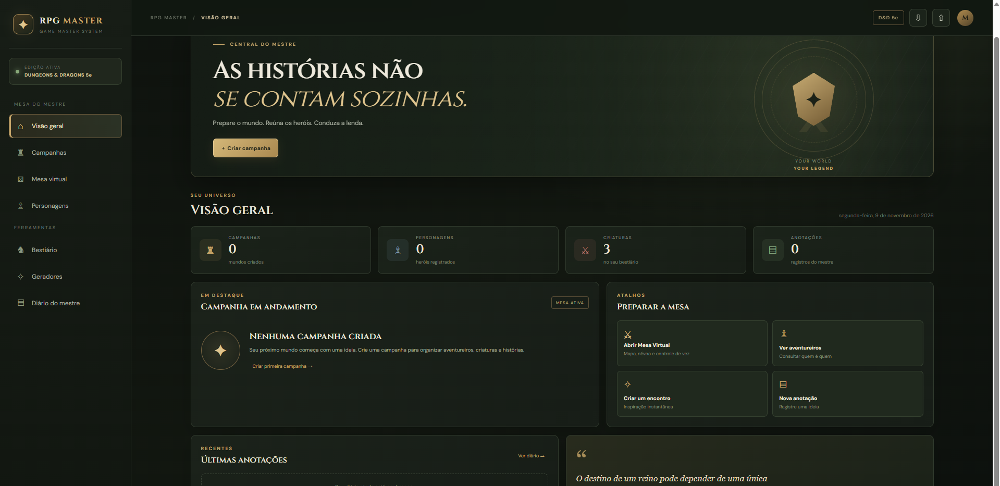
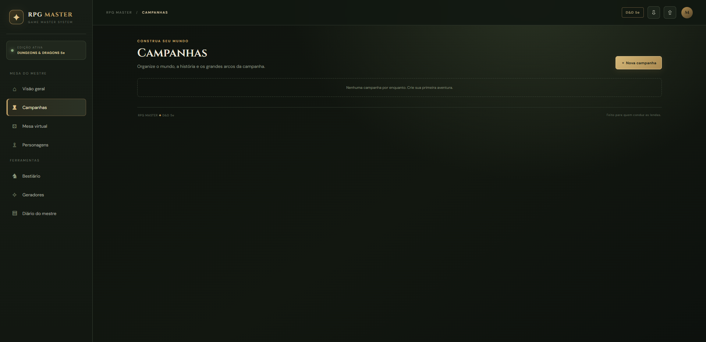
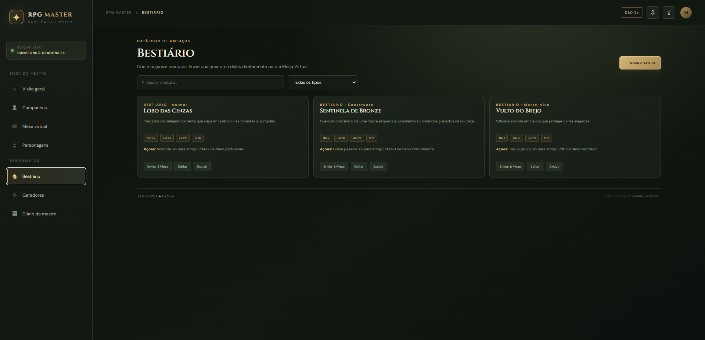
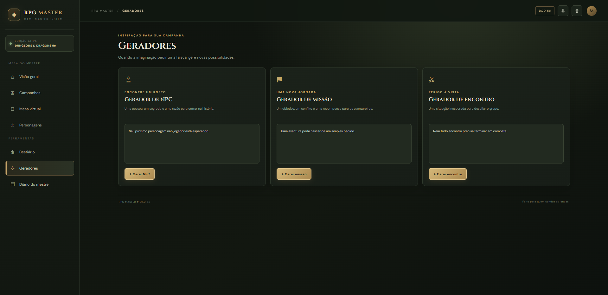
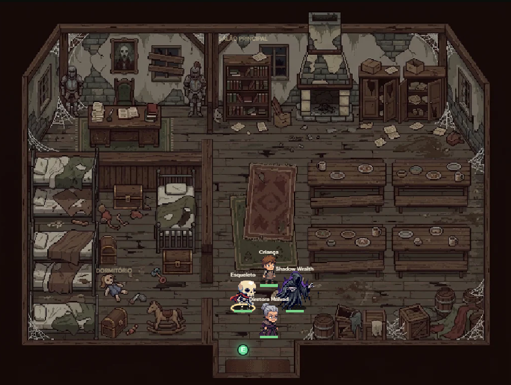
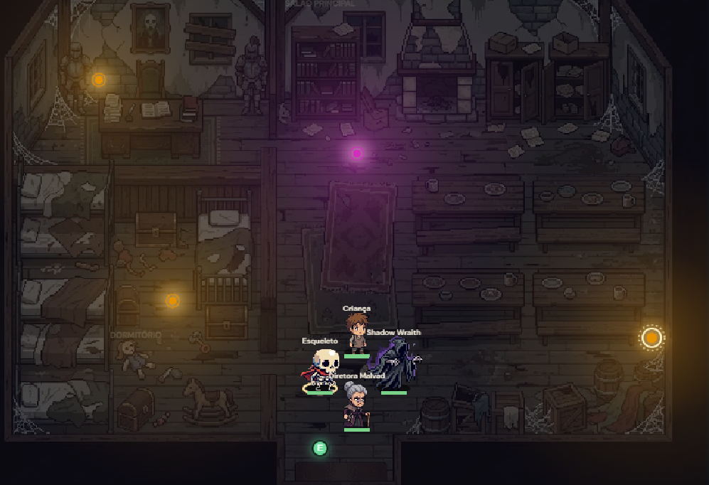

# RPG MASTER + Mesa Virtual

**Prepare o mundo. Conduza a lenda.**

Uma aplicação web desenvolvida para auxiliar mestres na preparação e condução de sessões presenciais de RPG de mesa, utilizando D&D 5ª edição como referência.

🌐 [Acessar aplicação](https://felipefurtuna.github.io/RPG-MASTER/) | 💻 [Código-fonte](https://github.com/FelipeFurtuna/RPG-MASTER)

---

## Sobre o projeto

O RPG MASTER é um projeto pessoal que reúne duas ferramentas integradas:

- **RPG MASTER:** ambiente de preparação do mestre, organização de campanhas, bestiário e geradores.
- **Mesa Virtual:** tabuleiro visual para utilização durante as sessões, com mapas, personagens, iluminação e efeitos de ambientação.

O objetivo é oferecer ferramentas para enriquecer as partidas presenciais, sem substituir a experiência tradicional de jogar RPG.

## Funcionalidades

### RPG MASTER

- Organização de campanhas e contexto narrativo.
- Consulta de personagens e suas características.
- Bestiário para organização de monstros e criaturas.
- Geradores de NPCs, missões e encontros.
- Ferramentas de apoio à preparação do mestre.

### Mesa Virtual

- Mapas ilustrados em estilo pixel art.
- Miniaturas de personagens e monstros animados.
- Movimentação individual dos participantes.
- Transições entre ambientes por portas.
- Névoa de guerra e campo de visão.
- Controle manual da vez dos participantes.
- Controle visual de vida, dano e cura.
- Efeitos visuais de condições e elementos.
- Iluminação dinâmica configurável.
- Chuva, noite e efeitos climáticos.
- Música e efeitos sonoros.
- Inventário e títulos cinematográficos.

### Filosofia do projeto

O RPG continua sendo presencial:

- Os jogadores utilizam suas próprias fichas.
- As rolagens são feitas com dados físicos.
- Não existe rolador de dados digital.
- Não existe iniciativa automática.
- O controle de combate é visual e manual, auxiliando o mestre durante a sessão.

---

## Demonstração visual

As imagens abaixo mostram funcionalidades reais da aplicação.

### RPG MASTER

**Tela inicial**



**Campanhas**



**Bestiário**



**Geradores**



### Mesa Virtual

**Mapa e personagens**



**Iluminação dinâmica**



---

## Tecnologias utilizadas

| Tecnologia | Aplicação |
|---|---|
| HTML5 | Estrutura das interfaces |
| CSS3 | Layout, identidade visual e responsividade |
| JavaScript | Lógica e interações |
| Canvas API | Renderização e interação visual |
| localStorage | Persistência local |
| JSON | Exportação e importação de dados |
| GitHub Pages | Hospedagem da aplicação |

## Estrutura do projeto

```text
RPG-MASTER/
├── assets/
│   ├── rpg-master-banner.svg
│   └── screenshots/
├── docs/
│   ├── PORTFOLIO.md
│   └── SCREENSHOTS.md
├── app.js
├── index.html
├── mesa-virtual.html
├── style.css
├── .gitignore
└── README.md
```

## Como executar localmente

1. Clone ou baixe o repositório.
2. Mantenha os arquivos principais na mesma pasta.
3. Abra um terminal dentro da pasta do projeto.
4. Execute:

```powershell
py -m http.server 8000
```

5. Acesse no navegador:

```text
http://localhost:8000
```

Também é possível utilizar a extensão Live Server do Visual Studio Code.

## Publicação

O projeto está hospedado pelo GitHub Pages.

**Endereço público:**

https://felipefurtuna.github.io/RPG-MASTER/

## Dados e privacidade

- Os dados são armazenados localmente no navegador.
- Esta versão não utiliza backend ou banco de dados remoto.
- Não existe sincronização automática entre dispositivos.
- Backups podem ser utilizados para transferir informações entre ambientes.

Não publique informações pessoais de jogadores, senhas ou backups privados no repositório público.

## Participação no desenvolvimento

O projeto foi idealizado e conduzido pelo autor, que definiu a proposta, estabeleceu prioridades, tomou decisões de interface e experiência, selecionou referências, testou funcionalidades e orientou correções e melhorias.

A implementação e evolução do código contaram com assistência de ferramentas de inteligência artificial, utilizadas como apoio durante o desenvolvimento.

O projeto demonstra experiência prática com definição de requisitos, organização de funcionalidades, testes, validação de interfaces e evolução de uma aplicação web.

Para conhecer melhor as decisões e a participação no projeto, consulte [Documentação de Portfólio](docs/PORTFOLIO.md).

## Próximas melhorias

- Expansão dos mapas e ambientes.
- Novos recursos de ambientação.
- Melhorias de organização e manutenção do código.
- Evolução da persistência e sincronização dos dados.

## Créditos

Projeto independente, não afiliado, patrocinado ou endossado pela Wizards of the Coast.

Dungeons & Dragons é uma marca de seus respectivos titulares.

O repositório ainda não possui licença open-source definida. A disponibilização pública não significa autorização irrestrita de reutilização.
