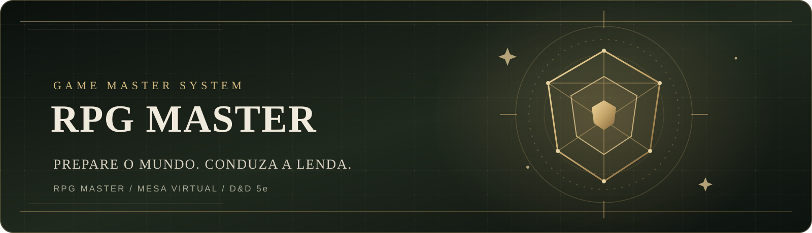

<div align="center">
  
  <h1>RPG MASTER + Mesa Virtual</h1>
  <p><strong>Ferramentas para preparar, organizar e conduzir sessões presenciais de RPG de mesa.</strong></p>
  <p>
    <a href="https://felipefurtuna.github.io/RPG-MASTER/"><strong>🌐 Acessar aplicação</strong></a>
    ·
    <a href="https://github.com/FelipeFurtuna/RPG-MASTER"><strong>⌘ Código-fonte</strong></a>
  </p>
  <p><sub>Projeto pessoal em desenvolvimento · D&D 5ª edição como referência de jogo</sub></p>
</div>
---
Sobre o projeto
O RPG MASTER é uma aplicação web criada para apoiar a preparação e a condução de campanhas presenciais de RPG. O projeto reúne dois módulos distintos, que trabalham em conjunto:
RPG MASTER: central de preparação do mestre, organização narrativa e consulta de informações.
Mesa Virtual: tabuleiro visual para uso durante a sessão, com mapas, miniaturas, iluminação e ambientação.
A proposta é complementar a experiência presencial — não substituir as fichas físicas, os dados ou as decisões dos jogadores.
Acesse
Recurso	Link
Aplicação publicada	felipefurtuna.github.io/RPG-MASTER
Repositório público	github.com/FelipeFurtuna/RPG-MASTER
Documentação de portfólio	docs/PORTFOLIO.md
Módulos e funcionalidades
1. RPG MASTER — preparação do mestre
Organização de campanhas, cenários e premissas narrativas.
Cadastro de aventureiros como referência para o mestre: jogador, raça, classe, nível e observações.
Bestiário para criar e organizar criaturas, com informações descritivas e de combate.
Geradores de NPCs, missões e encontros para apoiar a improvisação.
Diário do mestre para registrar pistas, ideias, acontecimentos e segredos.
Exportação e importação de backups em JSON.
2. Mesa Virtual — apoio visual à sessão
Mapas ilustrados, ambientes e miniaturas movimentáveis.
Névoa de guerra e campo de visão.
Transições individuais entre ambientes por portas.
Controle manual da vez dos participantes.
Controle de pontos de vida, dano e cura para miniaturas que usam controle digital.
Efeitos visuais de condições, magia e elementos.
Clima, chuva e modo noturno.
Iluminação dinâmica configurável, com fontes de luz, alcance, intensidade, cor e tremulação.
Player de música e efeitos sonoros.
Inventário individual e títulos cinematográficos sobre o mapa.
Decisões de projeto
O jogo continua sendo presencial:
Os jogadores usam suas próprias fichas e rolam dados físicos.
Não há rolador de dados digital.
Não há iniciativa automática.
O controle de combate na Mesa Virtual é um apoio visual e manual para o mestre.
Tecnologias utilizadas
Tecnologia	Aplicação no projeto
HTML5	Estrutura das interfaces
CSS3	Layout, identidade visual e responsividade
JavaScript (Vanilla)	Regras de interface, estado e interações
Canvas API	Renderização e interação visual com o mapa
localStorage	Persistência local no navegador
JSON e File API	Exportação e importação de dados
GitHub Pages	Hospedagem estática da aplicação
O projeto não exige instalação de dependências ou etapa de build.
Estrutura do repositório
```text
RPG-MASTER/
├── index.html          # Interface principal do RPG MASTER
├── app.js              # Lógica e interações do RPG MASTER
├── style.css           # Estilos do RPG MASTER
├── mesa-virtual.html   # Módulo independente da Mesa Virtual
├── README.md           # Apresentação e documentação
├── assets/             # Materiais visuais da documentação
└── docs/               # Documentação complementar
```
A Mesa Virtual é mantida como um HTML independente, com sua implementação visual e recursos incorporados. Os dois módulos permanecem separados para que cada um tenha seu próprio fluxo de uso.
Executar localmente
Baixe ou clone este repositório.
Mantenha `index.html`, `app.js`, `style.css` e `mesa-virtual.html` na mesma pasta.
Inicie um servidor local nessa pasta. No Windows, por exemplo:
```powershell
   py -m http.server 8000
   ```
Abra `http://localhost:8000` no navegador.
Acesse a Mesa Virtual pelo menu do RPG MASTER.
Também é possível usar a extensão Live Server no Visual Studio Code.
Publicação
A aplicação é hospedada pelo GitHub Pages a partir da branch `main`, diretório raiz (`/(root)`).
Endereço público:  
https://felipefurtuna.github.io/RPG-MASTER/
Dados, privacidade e limitações
Os dados criados durante o uso ficam armazenados localmente no navegador.
Esta versão não possui backend, autenticação ou banco de dados remoto.
Os dados não são sincronizados automaticamente entre computadores ou navegadores.
Para transferir campanhas e configurações, use os recursos de exportação e importação de backup.
Não envie backups pessoais, informações privadas dos jogadores, senhas ou chaves de API para este repositório público.
Participação no desenvolvimento
O projeto foi idealizado e conduzido pelo autor, que definiu a proposta, priorizou funcionalidades, tomou decisões de experiência e direção visual, testou os fluxos e orientou as correções ao longo da evolução.
A implementação e a evolução do código contaram com assistência de ferramentas de inteligência artificial. Essa participação é descrita de forma transparente: o projeto demonstra também capacidade de levantar requisitos, avaliar resultados, identificar problemas, validar funcionalidades e conduzir um produto digital.
Veja uma descrição mais completa em Documentação de portfólio.
Capturas de tela
As capturas reais da aplicação serão adicionadas após uma seleção das telas finais. Para manter a documentação fiel ao produto, esta seção não usa mockups ou imagens ilustrativas como se fossem screenshots. Consulte docs/SCREENSHOTS.md para a lista de imagens recomendadas.
Próximas evoluções
Ampliar a galeria com capturas reais da aplicação.
Melhorar a organização interna e a manutenção dos módulos.
Expandir mapas, recursos visuais e opções de ambientação.
Avaliar uma solução de sincronização remota como evolução futura, sem comprometer o funcionamento local atual.
Créditos e marcas
Projeto independente, não afiliado, patrocinado ou endossado pela Wizards of the Coast. Dungeons & Dragons é uma marca de seus respectivos titulares. Materiais visuais de terceiros devem ser utilizados respeitando seus direitos e licenças.
Este repositório ainda não possui uma licença open-source definida. A publicação pública do código não concede, por si só, autorização irrestrita para reutilização.
